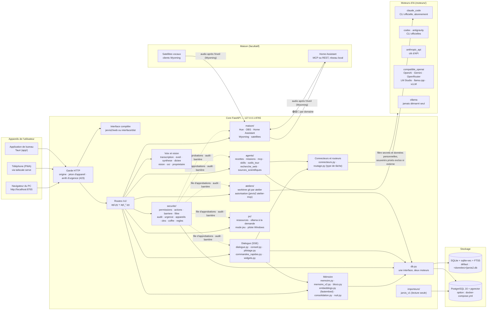

# Architecture

JARVIS 2 est un **Core** Python (FastAPI) qui tourne sur votre PC et sert lui-même son **interface** React précompilée. Tout passe par l'API HTTP du Core, sous `/v1/` : l'interface ne parle jamais directement à une IA, à la base ou au système. Les choix et leurs raisons sont détaillés dans [DECISIONS.md](DECISIONS.md) ; ce document décrit ce qui existe dans le code.

## Vue d'ensemble

## Le chemin d'un message

1. L'interface envoie le message à `POST /v1/dialogue`. La **garde** HTTP de `api.py` refuse une origine inconnue (403), un appareil sans jeton valide (401), et toute écriture pendant l'arrêt d'urgence (423).
2. Avant l'IA, l'interface demande au Core si la phrase est une **commande rapide** (`POST /v1/commandes-rapides/executer`) : si oui, l'action est appliquée ou demandée sans IA.
3. Le **routeur par type de tâche** (`routage.py`) range le message (code, raisonnement, rapide, privé) par des règles locales, puis, seulement si elles hésitent, par un petit modèle Ollama déjà lancé ; chaque type a sa route, rétrogradée si son score mesuré baisse. À défaut, le **routeur** des connecteurs (`connecteurs.py`) choisit : choix explicite, sinon celui imposé à la conversation, sinon le connecteur préféré et les connecteurs disponibles. Un sujet privé n'est confié qu'à une IA locale ; un connecteur « à risque » n'est jamais choisi seul ; un plafond de dépenses atteint fait passer à une autre IA.
4. Le **dialogue** (`dialogue.py`) assemble les consignes, la mémoire (noyau, blocs, souvenirs trouvés), l'historique et le message. Pour un moteur externe : souvenirs privés exclus, réponses locales privées masquées, puis tout le texte passe par le filtre `securite/filtre.py`.
5. La réponse arrive en flux **SSE** (`debut`, `delta`, `fin`, `erreur`…). Le tour est suivi par la **barrière d'injection** (`securite/barriere.py`) et par l'arrêt d'urgence, qui peut l'annuler. Le bloc `<actions>` éventuel est validé par `pilotage.py`, les blocs `<widget>` par `widgets.py` (listes fermées, fragment réécrit) ; les outils proposés au modèle pour ce tour (outils MCP activés, skills approuvés, moins de 12, choisis par le sens) viennent d'`agents/outils_tour.py` ; le détecteur `securite/invente.py` signale une réponse qui prétend avoir agi sans action réelle.
6. Toute action qui agit passe par la **file d'approbations** (`securite/permissions.py`, approbation liée à l'empreinte du plan exact, pile d'annulation de 24 h) et laisse une trace dans le **journal d'audit** chaîné.

## Stockage

`db.py` expose une seule interface (le sous-ensemble d'asyncpg dont le Core se sert) et deux moteurs :

- **SQLite** (`db_sqlite.py`, défaut) : un fichier, aucune installation ; vecteurs par l'extension sqlite-vec (à défaut, la même fonction en Python), plein texte par FTS5 ; migré automatiquement au démarrage du serveur.
- **PostgreSQL 16 + pgvector** (`db_postgres.py`, option) : rôles séparés — un propriétaire pour les migrations, un rôle applicatif sans droit sur la structure, un rôle d'audit distinct.

Chaque migration existe pour les deux moteurs (`migrations/` et `migrations/sqlite/`, mêmes noms). `jarvis2 stockage copier --vers sqlite|postgres` copie tout d'un moteur vers l'autre, vers une cible vide, et vérifie la copie.

## Rôle des dossiers du dépôt

| Dossier | Contenu |
|---|---|
| `core/` | le Core Python (paquet `jarvis2`), ses tests (`core/tests`) et sa configuration de paquet (`pyproject.toml`, `uv.lock`) |
| `interface/` | l'interface HUD (React 19 + Vite + TypeScript), précompilée dans `interface/dist` et livrée dans la roue ; règles visuelles : [interface/DESIGN.md](../interface/DESIGN.md) |
| `app/` | l'application de bureau (Tauri 2) : une fenêtre sur l'interface du Core, icône de notification, raccourcis globaux, liens `jarvis://` |
| `infra/` | `creer_env.py` (crée `.env` avec des mots de passe aléatoires) et l'initialisation de PostgreSQL (`infra/postgres/initdb`) |
| `docs/` | plan, décisions, guides ; `docs/recettes/` : recette d'exemple |
| `install.ps1`, `install.sh` | scripts d'installation (voir [INSTALLATION.md](INSTALLATION.md)) |
| `docker-compose.yml` | PostgreSQL + pgvector, publié sur 127.0.0.1 seulement |

## `core/jarvis2` : sous-paquets

| Dossier | Rôle |
|---|---|
| `moteurs/` | connecteurs d'IA derrière un contrat commun (`base.py` : `generate`, `stream`, `list_models`, `health`). `claude_code.py` (CLI `claude -p`, abonnement vérifié), `codex.py`, `antigravity.py` (CLI officielles), `sousprocessus.py` (dossier vide, environnement sans clés), `anthropic_api.py`, `compatible_openai.py` (API et serveurs locaux), `ollama.py`, `telemetrie.py` (latence, jetons, coût, plafonds) |
| `securite/` | `permissions.py` (🟢🟡🔴, file d'approbations, empreinte du plan, pile d'annulation, « toujours autoriser »), `actions.py` (actions déclarées), `regles.py` (règles de protection), `jokers.py` (motifs `*` et `{nom}`), `barriere.py` (barrière d'injection), `filtre.py` (secrets et données personnelles), `invente.py` (exécution inventée), `audit.py` (journal chaîné), `urgence.py` (arrêt d'urgence), `appareils.py` (jetons et jumelage), `cles.py` (clés d'accès WebAuthn), `coffre.py` (clés d'API) |
| `agents/` | `recettes.py` (recettes YAML planifiées, planificateur), `missions.py` (recherche, brainstorm, revue), `mcp.py` (client MCP stdio), `skills.py` (skills `SKILL.md` : import, revue, empreinte, exécution confinée), `outils_tour.py` (outils proposés à chaque tour, choisis par le sens), `recherche_web.py` (SearXNG), `sources_scientifiques.py` (OpenAlex, arXiv, PubMed, Europe PMC) |
| `ateliers/` | ateliers Claude Code : `gestionnaire.py` (un worktree git et une branche `jarvis/atelier-…` par atelier, pause, reprise, clôture), `autorisation.py` et `mcp_autorisation.py` (chaque outil de Claude Code passe par JARVIS : écriture hors du worktree refusée), `processus.py`, `veille.py` (veille en lecture seule de vos propres sessions Claude Code) |
| `pc/` | `ressources.py` (CPU, RAM, GPU, VRAM, sans wmic), `ollama.py` (Ollama à la demande, arrêté après inactivité), `jeu.py` (mode jeu = veille stricte), `pilote.py` (abstraction) et `windows.py` (le seul endroit qui règle réellement Windows) |
| `maison/` | connecteurs facultatifs, désactivés par défaut : `hue.py` (API locale du pont Philips Hue), `obs.py` et `websocket.py` (OBS WebSocket v5), `home_assistant.py` (Home Assistant par son serveur MCP ou l'API REST, niveaux par domaine), `wyoming.py` (transcription et synthèse offertes à Home Assistant et aux satellites), `satellites.py` (satellites, pièces, profils par personne, plafonds de volume) ; voir [HOME_ASSISTANT.md](HOME_ASSISTANT.md) |
| `importeurs/` | sources d'import génériques, lues en lecture seule ; `jarvis_v1.py` (sauvegarde `pg_dump` restaurée dans une base d'attente PostgreSQL) |
| `migrations/` | migrations SQL PostgreSQL ; `migrations/sqlite/` : leurs jumelles SQLite |

## `core/jarvis2` : modules principaux

| Module | Rôle |
|---|---|
| `__main__.py` | commande `jarvis2` : `serveur`, `migrer`, `docteur`, `materiel`, `jumeler`, `verifier-audit`, `lever-urgence`, `importer`, `verifier-import`, `stockage`, `memoire`, `sauvegarde`, `atelier-mcp` (interne) |
| `api.py` | application FastAPI, garde HTTP, `/v1/sante`, `/v1/etat`, `/v1/dialogue`, service de l'interface |
| `api_*.py` | routes par domaine : sécurité, mémoire, connecteurs, agents, ateliers, pilotage, PC, maison, voix, bureau et téléphone, matin, coûts… |
| `config.py` | réglages du Core (`.env` ou `jarvis2.env`, variables `JARVIS2_*`) |
| `config_locale.py` | configuration personnelle `config.toml`, hors du dépôt |
| `dialogue.py`, `conversations.py`, `titrage.py` | dialogue en flux, historique, titres et résumés de conversation |
| `conseil.py` | conseil multi-IA : avis en parallèle, puis synthèse |
| `connecteurs.py` | catalogue des connecteurs, état, clés, routeur, plafonds |
| `memoire.py`, `memoire_v2.py`, `blocs.py`, `rappel.py`, `contradiction.py` | recherche hybride, niveaux de confidentialité, classement v2, blocs éditables, porte de rappel sans IA, changement d'avis |
| `consolidation.py`, `nuit.py` | tâches de nuit : une IA **locale** tire des souvenirs des conversations du jour, rien n'est effacé |
| `embeddings.py`, `telechargements.py` | embeddings locaux (fastembed) ; gros téléchargements, jamais sans accord |
| `pilotage.py`, `commandes_rapides.py` | actions proposées par JARVIS (validées par le Core) ; commandes rapides sans IA |
| `routage.py`, `api_routage.py` | routeur par type de tâche : classifieur local, routes, scores mesurés, rétrogradation |
| `widgets.py`, `api_widgets.py` | widgets générés dans le HUD : validation par listes fermées, épinglage |
| `api_skills.py` | routes des skills et réglages du client MCP |
| `chantiers.py`, `connaissances.py`, `profil.py`, `matin.py`, `ameliorations.py` | tâches suivies, connaissances par domaine, profil guidé, accueil du matin, amélioration continue |
| `voix.py`, `transcription.py`, `eveil.py`, `fin_tour.py`, `coupure.py`, `synthese.py`, `dictee.py`, `proprietaire.py`, `latence.py` | voix : transcription Whisper locale, éveil « Dis Jarvis », fin de tour, coupure, synthèse vocale, dictée globale, reconnaissance du propriétaire, mesures |
| `vision.py`, `ocr.py`, `ecran.py`, `creations.py` | vision sur demande (OCR d'abord, modèle local), mode sans écran, créations HTML en bac à sable |
| `protocole.py`, `push.py`, `partages.py`, `tailscale.py` | liens `jarvis://`, notifications Web Push, « Partager vers JARVIS », lecture de l'état Tailscale |
| `flux_donnees.py`, `couts.py` | « Où partent mes données », coûts et jauges |
| `diagnostic.py`, `materiel.py` | `jarvis2 docteur` ; table matériel → modèle conseillé |
| `sauvegarde.py`, `stockage_copie.py` | sauvegarde chiffrée et vérifiée ; copie SQLite ⇄ PostgreSQL |
| `journal.py` | journaux dans le dossier des données, secrets masqués |

## `interface/src`

| Fichier ou dossier | Rôle |
|---|---|
| `main.tsx`, `App.tsx` | point d'entrée et HUD : barre d'état, vues, bouton « Arrêt d'urgence » |
| `api.ts`, `auth.ts`, `sse.ts`, `types.ts` | accès à l'API du Core avec le jeton de l'appareil, lecture du flux SSE, types partagés |
| `composants/` | une vue ou un panneau par fichier : `Dialogue`, `Historique`, `Memoire` et `VueMemoire`, `Connecteurs`, `Agents`, `Ateliers`, `Ameliorations`, `Reglages`, `Securite`, `Demandes`, `Jumelage`, `PC`, `Maison`, `Skills`, `Couts`, `FluxDonnees`, `Palette` (Ctrl+K), `Orbe` (thème Présence)… |
| `skills.ts`, `widgets.ts`, `routage.ts`, `maison.ts` | skills et outils MCP, widgets du HUD (filtrés par DOMPurify), routeur par type de tâche, maison |
| `commandes.ts` | palette Ctrl+K, commandes « / » de la saisie et raccourcis : une seule liste |
| `reglages.ts` | registre de la vue Réglages : catégories, sections, recherche, adresses `#reglages/<section>` |
| `pilotage.ts` | ce que l'interface fait des actions validées par le Core |
| `niveaux.ts`, `donnees.ts`, `couts.ts`, `connaissances.ts` | niveaux de confidentialité de la mémoire, « Où partent mes données », coûts, connaissances |
| `voix.ts`, `voixAvancee.ts`, `eveil.ts`, `synthese.ts`, `veilleClaude.ts` | voix, transcription, éveil, synthèse, alertes de la veille Claude Code |
| `webauthn.ts` | clés d'accès |
| `bureau.ts` | liens `jarvis://`, appel de décision, partages reçus, gadget de bureau |
| `theme.ts`, `animations.ts`, `presence.ts`, `usePresence.ts`, `styles/` | thèmes, animations, orbe de particules, feuilles de style |
| `texte.tsx` | rendu Markdown minimal en nœuds React, jamais de HTML brut |
| `*.test.ts` | tests Vitest (`npm run verifier`) |
